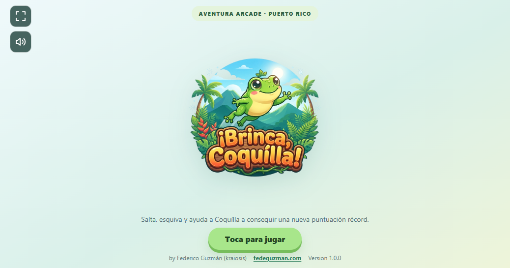

# ¡Brinca, Coquílla!

A fullscreen-ready, responsive arcade game starring Coquílla, a playful frog inspired by Puerto Rico's coquí. Jump through an island-inspired adventure, dodge hazards, and catch flies to boost your score.



## The story

Coquílla is off on a lively hopping adventure through a Puerto Rican mangrove habitat. Bushes, grasses, and mangrove roots decorate the path. Thistles, stones, snakes, wooden bridges, and holes in the ground are obstacles; the snake faces Coquílla as it moves toward her. Flies appear along the way and award bonus points when caught. Help Coquílla avoid the hazards, collect flies, and set a new high score.

The gameplay scene features drifting clouds, alternating sunny and rainy weather, animated mangrove ground details, and a frog whose legs stretch during jumps. The game speeds up as the run continues.

## How to play

1. Select **Toca para jugar** to start.
2. Jump over thistles, stones, snakes, wooden bridges, and holes.
3. Catch flies for **100 bonus points** each.
4. Keep going for as long as you can and beat your high score.
5. After a game over, tap or click the game, or press **Space** or **Arrow Up**, to try again.

### Controls

| Action | Control |
| --- | --- |
| Jump | **Space**, **Arrow Up**, or tap/click the game |
| Start | Select **Toca para jugar** |
| Restart | Tap/click the game, **Space**, or **Arrow Up** after game over |
| Toggle music | Select the speaker button |
| Fullscreen | Select the fullscreen button when supported by the browser |

The current score, number of flies collected, and high score are shown during play. The game-over screen shows the final score and high score. The high score is kept for the current page session; it resets when the page is reloaded.

The speaker button toggles the background music. Music begins after starting the game to comply with browser autoplay restrictions.

## Run locally

Python is **not required**. To play locally, open the project folder and double-click `index.html` (or choose it from your browser's **Open File** menu). Keep the HTML, JavaScript, image, and music files together in the same folder.

You can also serve the folder over HTTP with any local web server you prefer. For example, with Node.js:

```bash
npx serve .
```

Or, with Python installed:

```bash
python -m http.server 8000
```

Open the local address printed by your server (for example, <http://localhost:8000>) and select **Toca para jugar**. No specific server or runtime is required; any static web server that serves the project files works.

## Browser and device compatibility

The game is built with standard HTML, CSS, JavaScript, and Canvas APIs and is designed for modern desktop and mobile browsers:

- **Desktop:** Chrome, Edge, Firefox, and Safari on Windows, macOS, and Linux computers.
- **Mobile and tablet:** Safari on iPhone and iPad; Chrome and other modern browsers on Android phones and tablets.
- **Input:** Keyboard on computers; touch on phones and tablets; mouse or touchpad clicks are also supported.
- **Display:** The game layout adapts to different screen sizes and orientations.

Use an up-to-date browser for the best experience. Fullscreen support varies by browser. Safari on iPhone does not provide the standard webpage fullscreen API; use Safari's **Share → Add to Home Screen** option for a more immersive experience.

## Technology

- HTML and CSS for the splash screen, controls, responsive layout, and game interface.
- Vanilla JavaScript and the HTML Canvas 2D API for the game loop, animation, collision detection, scoring, and drawing.
- A locally stored MP3 file for background music, with attribution in `AUDIO-CREDITS.txt`.
- No frameworks, external runtime services, or build tools.

## Credits

**Game:** Federico Guzmán (kraiosis)  
**Website:** [fedeguzman.com](https://fedeguzman.com)

**AI collaboration:** Game development and documentation were assisted by an AI assistant using Copilot SDK in VS Code.

**Human-created concepts:** The game title, **¡Brinca, Coquílla!**, the character name, **Coquílla**, and the gameplay concept were created by the author, Federico Guzmán. Just for Fun!

**Human-AI interaction summary:** Federico Guzmán directed the project through iterative requests, reviewed the results, and provided feedback on gameplay, visuals, responsiveness, audio, and documentation. The AI assistant implemented requested changes, updated project documentation, and helped verify behavior. Creative direction and final decisions remained with the human developer.

**Estimated development time:** Approximately 3 hours of active development, estimated retrospectively; time was not formally tracked.

**Background music:** “Hungry Dino - 9 Chiptune Tracks + 10 SFX” by SketchyLogic, track “HappyLevel.” Licensed under [Creative Commons Attribution 3.0](https://creativecommons.org/licenses/by/3.0/). The WAV source was converted to MP3 for browser playback. See [AUDIO-CREDITS.txt](AUDIO-CREDITS.txt) for the source link.

## Project files

- `index.html` — page structure, styles, splash screen, and audio element.
- `brincacoquilla.js` — game logic and canvas rendering.
- `readme-featured.png` — screenshot of the splash screen used as the README feature image.
- `brinca-coquilla-logo.png` — original splash logo with its pale background removed.
- `brinca-coquilla-logo-splash.jpg` — original splash artwork source.
- `background-music.mp3` — local background music.
- `AUDIO-CREDITS.txt` — audio attribution details.

No project-wide software license is specified in this repository.
